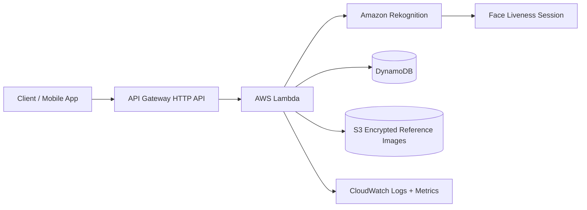

# Cloud Identity Verification on AWS

A production-oriented serverless identity verification service built with **AWS Rekognition, Lambda, API Gateway, DynamoDB, S3, CloudWatch, and AWS SAM**. The system supports reference-image enrollment, face liveness orchestration, confidence-threshold verification, encrypted storage, least-privilege service access, and operational metrics.

> **Privacy note:** This project is intended for consent-based identity verification demos. Do not use it for covert identification or surveillance. Use only images you own or have permission to process.

## Why this project

The goal is to demonstrate backend/cloud engineering rather than a notebook-only computer-vision demo:

- REST-style serverless APIs
- AWS infrastructure as code
- S3 + DynamoDB persistence
- Rekognition face matching and Face Liveness APIs
- input validation and threshold-based decisions
- IAM-scoped service permissions
- CloudWatch custom metrics and structured logs
- unit tests with AWS clients mocked
- reproducible deployment with AWS SAM

## Architecture



## API

| Method | Route | Purpose |
|---|---|---|
| `GET` | `/health` | Health check |
| `POST` | `/enroll` | Validate and store one reference face |
| `POST` | `/liveness/session` | Create a Rekognition Face Liveness session |
| `GET` | `/liveness/{session_id}` | Read liveness status/confidence |
| `POST` | `/verify` | Require passing liveness and compare probe image with enrolled reference |

## Project structure

```text
aws-cloud-identity-verification/
├── src/
│   ├── app.py                 # Lambda entrypoint and route dispatch
│   ├── config.py              # Environment-driven configuration
│   ├── aws_clients.py         # AWS SDK clients/resources
│   ├── handlers/
│   │   ├── enroll.py          # Enrollment endpoint
│   │   ├── liveness.py        # Liveness endpoints
│   │   ├── verify.py          # Verification endpoint
│   │   └── health.py          # Health endpoint
│   ├── services/
│   │   ├── rekognition_service.py
│   │   ├── storage.py
│   │   └── metrics.py
│   └── utils/
│       ├── http.py
│       └── validation.py
├── tests/
│   ├── test_routes.py
│   ├── test_enrollment.py
│   ├── test_liveness.py
│   └── test_verification.py
├── scripts/
│   └── encode_image.py
├── template.yaml              # AWS SAM infrastructure
└── requirements.txt
```

The application is intentionally split into thin request handlers, service-layer AWS integrations, shared validation/HTTP utilities, and a small Lambda entrypoint. This keeps business logic testable and avoids coupling route handling directly to AWS SDK calls.

## Local setup

Python 3.12 is recommended.

```bash
python -m venv .venv
source .venv/bin/activate
pip install -r requirements-dev.txt
pytest
```

The unit tests mock AWS clients, so they do **not** require AWS credentials or make network calls. The current modular suite contains **9 tests** covering routing, enrollment, liveness, verification success/failure paths, and persistence interactions.

## Deploy with AWS SAM

Prerequisites:

- AWS CLI configured with a sandbox/dev account
- AWS SAM CLI
- Rekognition Face Liveness available in the chosen AWS Region

```bash
sam validate --lint
sam build
sam deploy --guided
```

## Security and reliability choices

- S3 public access is fully blocked.
- Reference images use server-side encryption and bucket versioning.
- DynamoDB has server-side encryption and point-in-time recovery.
- Lambda receives only the S3, DynamoDB, Rekognition, and CloudWatch permissions needed by the service.
- Verification requires a completed liveness session before face comparison.
- Images are size-limited and invalid base64 payloads are rejected.
- Enrollment rejects images with zero or multiple detected faces.
- CloudWatch metrics distinguish successful verification, failed matching, liveness/spoof failures, and service errors.
- Monitoring failures do not break customer verification requests.

## Resume-ready description

**Cloud Identity Verification | AWS Rekognition, Lambda, API Gateway, DynamoDB, S3**

- Built a serverless identity-verification service using AWS Rekognition, Lambda, API Gateway, and DynamoDB, supporting face matching and liveness-based verification through REST APIs.
- Added confidence-threshold validation, IAM-scoped service access, encrypted storage, and CloudWatch monitoring for failed matches, spoof/liveness failures, and service errors.
